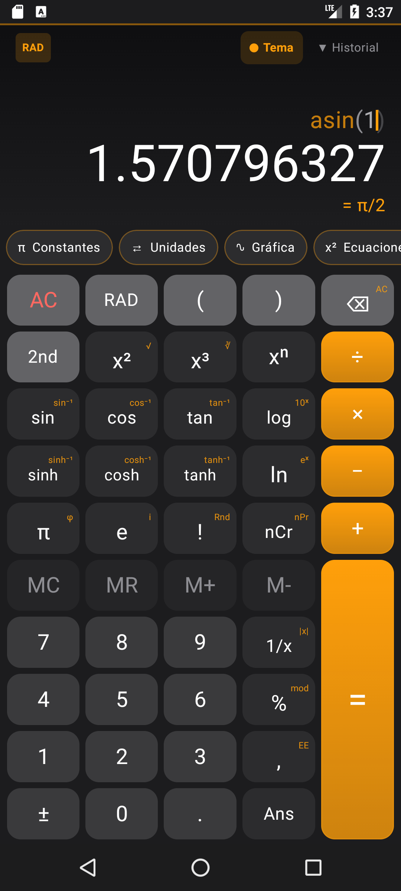
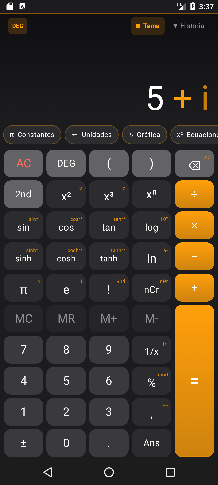
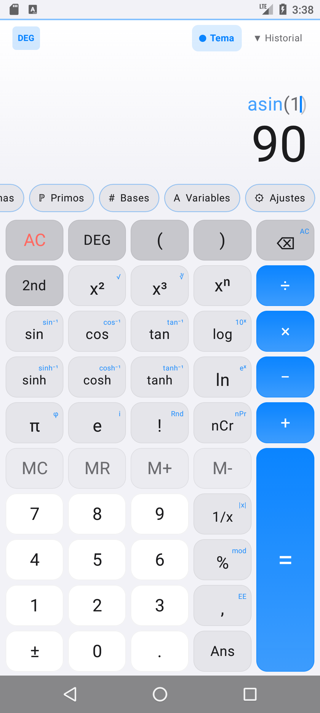
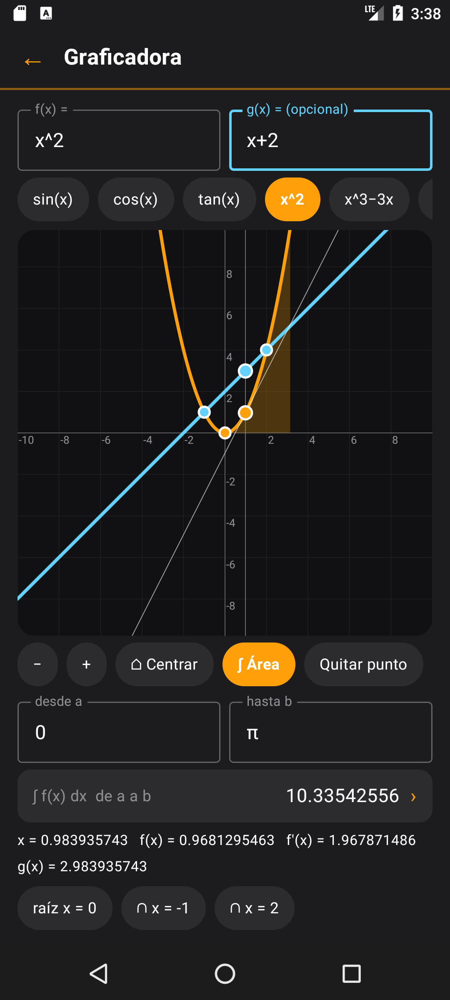
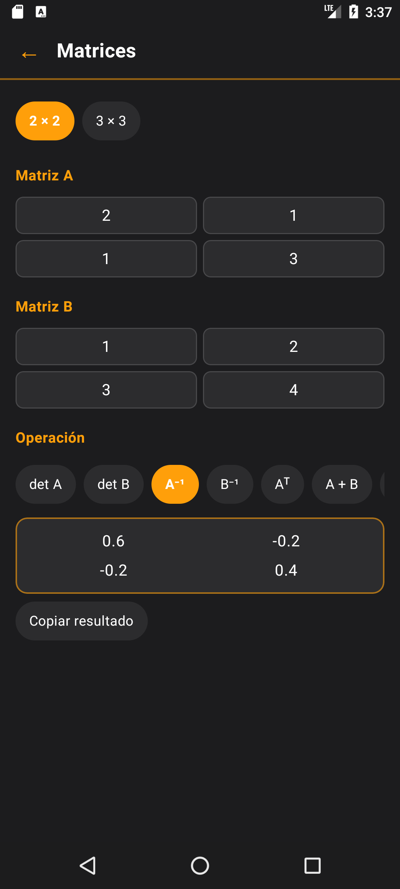
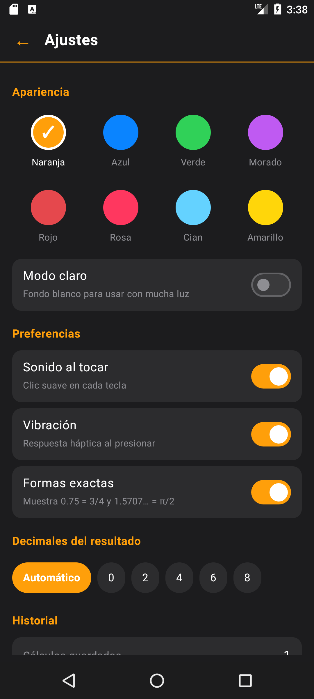
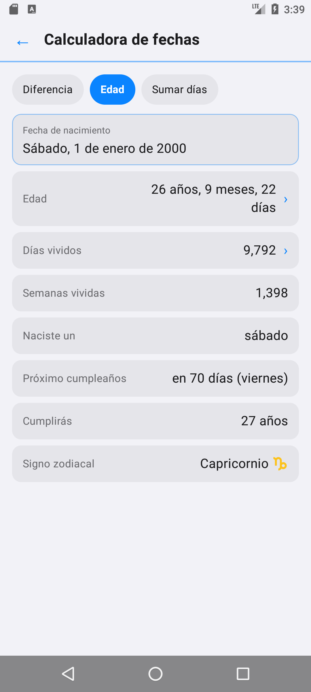
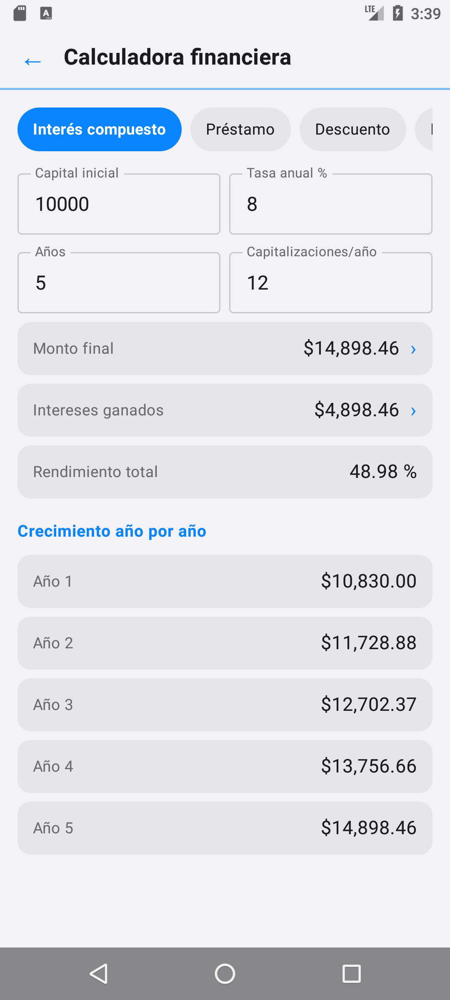
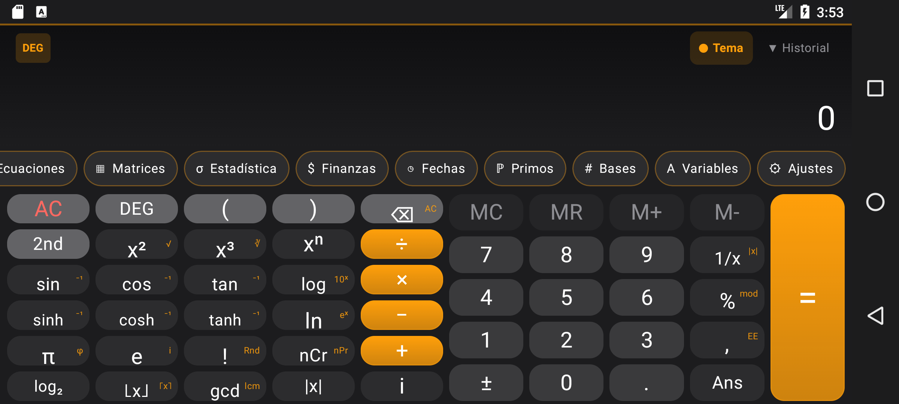

<div align="center">



# Calculadora Científica

**Calculadora científica completa para Android: más de 40 funciones, números complejos, matrices,
graficadora con derivadas e integrales y 12 herramientas, en una app ligera que funciona sin internet desde Android 7.0.**

[](#requisitos)
[](https://kotlinlang.org)
[](https://developer.android.com/jetpack/compose)
[](CHANGELOG.md)
[](#pruebas)
[](LICENSE)
[](https://github.com/HugoDavidRS/Proyecto_Zarate_P2/commits/main)

[Instalar](#instalación) · [Funciones](#funciones) · [Guía rápida](#guía-rápida) · [Estructura](#estructura-del-proyecto) · [Versiones](#historial-de-versiones) · [Preguntas frecuentes](#solución-de-problemas)

</div>

```
escribe → previsualiza → calcula → grafica → convierte → comparte
```

> Toda la potencia de una calculadora científica de escritorio, en el bolsillo y sin conexión.

---

## Contenido

- [Capturas](#capturas)
- [En números](#en-números)
- [Instalación](#instalación)
- [Guía rápida](#guía-rápida)
- [Funciones](#funciones)
- [Ejemplos](#ejemplos)
- [Estructura del proyecto](#estructura-del-proyecto)
- [Cómo funciona](#cómo-funciona)
- [Pruebas](#pruebas)
- [Historial de versiones](#historial-de-versiones)
- [Solución de problemas](#solución-de-problemas)
- [Contribuir](#contribuir)
- [Licencia](#licencia)

---

## Capturas

| Calculadora | Números complejos | Modo claro |
|:---:|:---:|:---:|
|  |  |  |
| **Graficadora** (derivada, tangente e intersecciones) | **Matrices** | **Ajustes** |
|  |  |  |
| **Calculadora de fechas** | **Finanzas** | |
|  |  | |

**Modo horizontal**: al girar el teléfono aparece una fila extra de funciones.



---

## En números

| Elemento | Cantidad |
|---|---|
| Funciones matemáticas | 40+ (trigonométricas, hiperbólicas, logaritmos, raíces, combinatoria, redondeo…) |
| Herramientas | 12 (gráfica, ecuaciones, matrices, estadística, finanzas, fechas, primos, unidades…) |
| Unidades de conversión | 73 en 11 categorías |
| Constantes científicas | 22 (matemáticas, física y química) |
| Temas de color | 8, más modo claro y modo oscuro |
| Versión mínima de Android | 7.0 (API 24) |
| Conexión a internet | No necesaria |
| Permisos especiales | Ninguno |

---

## Instalación

### Opción 1: instalar el APK (la más fácil)

1. Entra a la sección **[Releases](https://github.com/HugoDavidRS/Proyecto_Zarate_P2/releases)** del repositorio.
2. Descarga el archivo `CalculadoraCientifica-v3.0.0.apk` de la versión más reciente.
3. Ábrelo en tu teléfono. Si Android lo pide, permite **"Instalar apps de origen desconocido"** para tu navegador o administrador de archivos.
4. Abre **Calculadora Científica** desde el menú de apps.

### Opción 2: compilar con Android Studio

```bash
git clone https://github.com/HugoDavidRS/Proyecto_Zarate_P2.git
```

1. Abre Android Studio → **File → Open** → selecciona la carpeta `Proyecto_Zarate_P2`.
2. Espera a que termine la sincronización de Gradle (la primera vez descarga dependencias).
3. Conecta tu teléfono con la **depuración USB** activada o crea un emulador (**Device Manager**).
4. Presiona **Run ▶**.

### Opción 3: línea de comandos

```bash
# Windows
gradlew.bat assembleDebug          # genera app/build/outputs/apk/debug/app-debug.apk
gradlew.bat installDebug           # lo instala en el dispositivo conectado

# macOS / Linux
./gradlew assembleDebug
./gradlew installDebug
```

### Requisitos

| Para | Necesitas |
|---|---|
| Usar la app | Android 7.0 (API 24) o superior |
| Compilar | Android Studio reciente (compatible con AGP 9), JDK 17+ (incluido en Android Studio) y Android SDK 37 |
| Ejecutar las pruebas | Solo el JDK; las pruebas unitarias no necesitan dispositivo |

---

## Guía rápida

| Gesto | Qué hace |
|---|---|
| **Tocar** un botón | Escribe su función o número |
| **Mantener presionado** un botón | Usa la función pequeña de su esquina (por ejemplo `sin` → `sin⁻¹`, `e` → `i`, `%` → `mod`) |
| **Deslizar** sobre la pantalla de números | Borra el último elemento |
| **Tocar** la expresión | Mueve el cursor para corregir en medio |
| **Mantener presionado** el resultado | Lo copia al portapapeles |
| **Tocar** `= 3/4` o `= π/2` | Cambia la expresión a su forma exacta |
| **Tocar** `DEG` / `RAD` / `GRAD` | Cambia el modo de ángulo |
| **Tocar** `Tema` | Cambia el color de la app |
| **Tocar** un cálculo del historial | Reutiliza su resultado |
| **Girar** el teléfono | Muestra más funciones científicas |

Después de `=`, escribir un número empieza un cálculo nuevo; escribir un operador continúa desde el resultado.

---

## Funciones

### Calculadora

- **Operaciones**: `+ − × ÷`, potencias `xⁿ`, `x²`, `x³`, raíces `√` y `∛`, porcentaje, `mod`, notación científica `EE`, cambio de signo y recíproco `1/x`.
- **Trigonometría**: `sin`, `cos` y `tan`, sus inversas, y las funciones hiperbólicas con sus inversas, en grados, radianes o gradianes.
- **Logaritmos y exponenciales**: `log`, `ln`, `log₂`, `10ˣ` y `eˣ`.
- **Combinatoria y enteros**: factorial `!`, `nCr`, `nPr`, `gcd`, `lcm`, `⌊x⌋`, `⌈x⌉` y `|x|`.
- **Constantes**: `π`, `e`, `φ` y un número aleatorio `Rnd`.
- **Números complejos**: escribe `i`. Por ejemplo `(2+3i)×(1−i) = 5 + i`, y `√(-4) = 2i`.
- **Memoria y variables**: `MC`, `MR`, `M+`, `M-`, `Ans` y las variables `A` a `F`.
- **Formas exactas**: fracciones (`0.75 = 3/4`) y múltiplos de π (`1.5707… = π/2`).
- **Vista previa en vivo**, paréntesis faltantes en gris, expresión con colores y animación de error.
- **Historial** de 100 cálculos que se guarda al cerrar la app y se puede compartir.

### Herramientas

| Herramienta | Qué incluye |
|---|---|
| **π Constantes** | 22 constantes de matemáticas, física y química (c, G, h, Nₐ, k, R…). Se insertan con un toque |
| **⇄ Unidades** | 73 unidades en 11 categorías: longitud, masa, temperatura, área, volumen, velocidad, tiempo, datos, ángulo, energía y presión |
| **∿ Gráfica** | Grafica f(x) y g(x); muestra raíces, intersecciones, la derivada con su recta tangente y la integral definida con el área sombreada. Zoom con los dedos |
| **x² Ecuaciones** | Cuadráticas (con raíces complejas, discriminante y vértice) y sistemas de 2×2 |
| **▦ Matrices** | Matrices de 2×2 y 3×3: determinante, inversa, transpuesta, suma, resta, multiplicación y potencia |
| **σ Estadística** | Media, mediana, moda, varianza y desviación estándar (población y muestra), más regresión lineal con r, r² y predicción |
| **$ Finanzas** | Interés compuesto año por año, préstamos con tabla de amortización, descuentos con IVA y propinas entre personas |
| **◷ Fechas** | Diferencia entre fechas (incluye días hábiles), edad exacta, próximo cumpleaños, signo zodiacal y sumar o restar días |
| **ℙ Primos** | Si un número es primo, su factorización, divisores, primo anterior y siguiente, y MCD/MCM de varios números |
| **# Bases** | Conversión entre decimal, hexadecimal, octal y binario |
| **A Variables** | Guarda resultados en `A` a `F` y úsalos en cualquier cálculo |
| **⚙ Ajustes** | 8 temas, modo claro, sonido, vibración, decimales fijos, formas exactas, historial y tutorial |

### Extras

- **Widget "Último resultado"** para la pantalla de inicio.
- **Tutorial** de bienvenida la primera vez que se abre.
- **Accesibilidad**: TalkBack lee cada botón en español ("Dividir", "Raíz cuadrada"…).
- **Modo horizontal** con funciones adicionales.
- Los ajustes, el historial y las variables **se conservan** al cerrar la app o girar la pantalla.

---

## Ejemplos

| Escribe | Resultado |
|---|---|
| `2+3×4` | `14` |
| `sin(30)` (DEG) | `0.5`, `= 1/2` |
| `asin(1)` (RAD) | `1.570796327`, `= π/2` |
| `√(2)^2` | `2` |
| `5!` | `120` |
| `ncr(10,3)` | `120` |
| `(2+3i)×(1−i)` | `5 + i` |
| `√(-4)` | `2i` |
| `ln(-1)` | `3.141592654i` |
| `7 mod 3` | `1` |
| `2A + B` (con A = 4, B = 3) | `11` |
| `1/3 + 1/6` | `0.5`, `= 1/2` |

---

## Estructura del proyecto

```
app/src/main/java/com/example/proyectoparcial2/
├── MainActivity.kt         Punto de entrada; aplica el tema y muestra la calculadora
├── CalculatorScreen.kt     Pantalla principal: display, teclado, historial, gestos y estado
├── CalculatorEngine.kt     Motor de expresiones reales (analizador por descenso recursivo)
├── ComplexEngine.kt        Motor de números complejos y evaluación automática real → compleja
├── MathTools.kt            Lógica pura: estadística, unidades, raíces, cálculo, matrices,
│                           finanzas, fechas y teoría de números
├── ToolPanels.kt           Componentes compartidos + Constantes, Unidades, Bases y Ecuaciones
├── GraphPanel.kt           Graficadora: dos funciones, derivada, tangente e integral
├── MoreTools.kt            Estadística, Matrices, Variables, Finanzas, Fechas, Primos,
│                           Ajustes y tutorial
├── CalcWidget.kt           Widget de pantalla de inicio
└── ui/theme/               Tema de Material 3

app/src/main/res/
├── drawable/               Ícono (vectorial) y fondo del widget
├── layout/widget_calc.xml  Diseño del widget
├── xml/calc_widget_info.xml
└── values/                 Textos y tema

app/src/test/.../CalculatorEngineTest.kt   Pruebas unitarias
docs/                                      Capturas y procedimiento de desarrollo
```

---

## Cómo funciona

- **Analizador de expresiones.** `CalculatorEngine` convierte el texto en un número con un analizador por descenso recursivo (`expresión → término → unario → potencia → posfijo → primario`). Así respeta la precedencia de operadores, la multiplicación implícita (`2π`, `3sin(30)`) y la potencia asociativa a la derecha.
- **Real primero, complejo después.** `evaluateAny` intenta calcular con números reales. Si no se puede (por ejemplo `√(-4)`, o una expresión con `i`), repite el cálculo con `ComplexEngine`.
- **Formas exactas.** Las fracciones se obtienen con fracciones continuas, con denominador de hasta 10 000; los múltiplos de π se detectan dividiendo entre π.
- **Graficadora.** Se evalúa la función en cada columna de píxeles. El trazo se interrumpe en las asíntotas. Las raíces se encuentran por cambio de signo más bisección, y la integral se calcula con la regla de Simpson.
- **Interfaz.** Está hecha 100 % con Jetpack Compose. El estado que debe sobrevivir a la rotación usa `rememberSaveable`, y los ajustes, el historial y las variables se guardan con `SharedPreferences`.
- **Compatibilidad.** Se evitan las APIs que requieren Android 8 o más (por ejemplo `java.time`): las fechas usan un algoritmo propio de días desde 1970. El ícono tiene una versión especial para Android 7.

---

## Pruebas

```bash
gradlew.bat testDebugUnitTest      # Windows
./gradlew testDebugUnitTest        # macOS / Linux
```

`CalculatorEngineTest` cubre:

- evaluación de expresiones, precedencia y errores de sintaxis
- formato de números independiente del idioma del teléfono
- fracciones y múltiplos de π
- números complejos y variables
- estadística, regresión, raíces e integrales
- matrices (determinante e inversa)
- fechas, días hábiles y signo zodiacal
- números primos y finanzas

---

## Historial de versiones

El historial de commits conserva cada versión, y cada una tiene su etiqueta (`git checkout v1.0.0`, etc.).

| Versión | Cambios principales |
|---|---|
| **v3.0.0** | Números complejos, matrices, finanzas, fechas, primos, variables, regresión lineal, derivadas e integrales en la gráfica, modo claro, cursor editable, widget, tutorial, nuevo ícono y accesibilidad |
| **v2.0.1** | Ajustes del modo horizontal |
| **v2.0.0** | Constantes, unidades, estadística, bases, graficadora, ecuaciones, ajustes, modo horizontal, historial persistente y pruebas |
| **v1.3.1** | Botón de tema funcional y mejoras visuales |
| **v1.3.0** | Se retira el experimento DOOM; temas de color, vibración, animaciones y copiar resultado |
| **v1.2.0** | Experimento DOOM con un motor raycaster propio |
| **v1.1.0** | Experimento: botón DOOM con js-dos |
| **v1.0.0** | Primera calculadora científica funcional |
| **v0.1.0** | Plantilla base de Android Studio |

- Detalle de cada versión: [CHANGELOG.md](CHANGELOG.md)
- Cómo se desarrolló, qué problemas hubo y cómo se resolvieron: [docs/PROCEDIMIENTO.md](docs/PROCEDIMIENTO.md)

---

## Solución de problemas

<details>
<summary><b>"App no instalada" o Android bloquea el APK</b></summary>

Activa **Ajustes → Seguridad → Orígenes desconocidos** (Android 7) o permite instalar apps desde tu navegador o administrador de archivos (Android 8+). Si tenías otra versión firmada con otra clave, desinstálala primero.
</details>

<details>
<summary><b>Android Studio muestra errores al sincronizar Gradle</b></summary>

Usa una versión reciente de Android Studio (compatible con AGP 9) e instala el **Android SDK 37** desde **SDK Manager**. Después usa **File → Sync Project with Gradle Files**.
</details>

<details>
<summary><b>No se oye el sonido de las teclas</b></summary>

El sonido usa el volumen multimedia del teléfono. Súbelo y revisa que **Ajustes → Sonido al tocar** esté activado en la app.
</details>

<details>
<summary><b>El resultado sale como "Error de sintaxis"</b></summary>

Revisa que las funciones de dos valores lleven coma, por ejemplo `ncr(5,2)` o `gcd(12,18)`. Los paréntesis faltantes se completan solos (se muestran en gris).
</details>

<details>
<summary><b>¿Por qué sin(90) no da 1?</b></summary>

Revisa el modo de ángulo arriba a la izquierda: `sin(90)` da 1 en **DEG**, pero en **RAD** calcula el seno de 90 radianes.
</details>

<details>
<summary><b>¿Cómo agrego el widget?</b></summary>

Mantén presionado un espacio vacío de la pantalla de inicio → **Widgets** → **Calculadora Científica / Último resultado** y arrástralo.
</details>

---

## Contribuir

1. Haz un fork del repositorio.
2. Crea una rama: `git checkout -b mi-mejora`.
3. Asegúrate de que las pruebas pasen: `./gradlew testDebugUnitTest`.
4. Haz commit, sube tu rama y abre un Pull Request explicando el cambio.

Las ideas y los reportes de errores son bienvenidos en **Issues**.

---

## Licencia

Distribuido bajo la licencia **MIT**. Consulta [LICENSE](LICENSE).

<div align="center">

Hecho por **Hugo David** · [@HugoDavidRS](https://github.com/HugoDavidRS)

</div>
